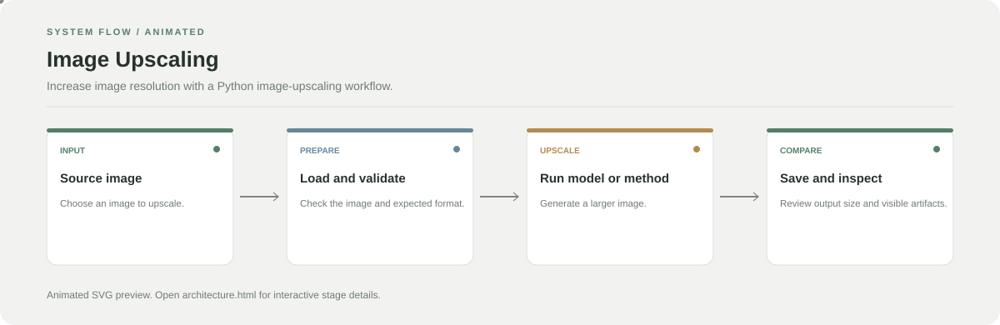

# Image Upscaling

**Increase image resolution with a Python image-upscaling workflow.**

[](https://github.com/chyk2468/Image-Upscaling-py)

## 1. Project Title & Tagline

Increase image resolution with a Python image-upscaling workflow.

## 2. Problem Statement

Low-resolution images lose detail when enlarged. This project provides a repeatable workflow for processing an image and inspecting the upscaled output.

## 3. Project Preview

Add a real screenshot or before/after comparison after running the project. Include the input and output with the same crop and scale where applicable.

[Open interactive architecture](architecture.html)

## 4. Overview

The project follows a reproducible pipeline from input data through its main processing step to an output that can be inspected and evaluated.

## 5. Key Features

- Load an input image.
- Run the configured upscaling method.
- Save the output image for comparison.
- Compare input and output dimensions and visual quality.

## 6. Architecture / Workflow



Open the [interactive architecture explorer](architecture.html) to select a stage and read its role.

## 7. Tech Stack

Python, image-processing libraries, and the upscaling model configured in the repository

## 8. Installation & Setup

```bash
git clone https://github.com/chyk2468/Image-Upscaling-py.git
cd Image-Upscaling-py
python -m venv .venv
```

Activate the environment and install the dependencies listed by the project.

## 9. Usage

Run the repository's documented entry point, provide an input image, and inspect the saved result. Verify the configured model weights and output path before processing a large batch.

## 10. Project Structure

Start with the main Python script or notebook, then inspect model loading, image preprocessing, and output-writing code.

## 11. Results & Demo

Add before/after samples and a consistent quality comparison, such as image dimensions and a perceptual metric, after running the project.

## 12. Future Enhancements

- Add batch processing.
- Provide before/after visual comparison.
- Document model weights and licence.
- Add tests for image formats and output dimensions.

## 13. License

Check the repository and model-weight licences before redistributing generated outputs or model files.
