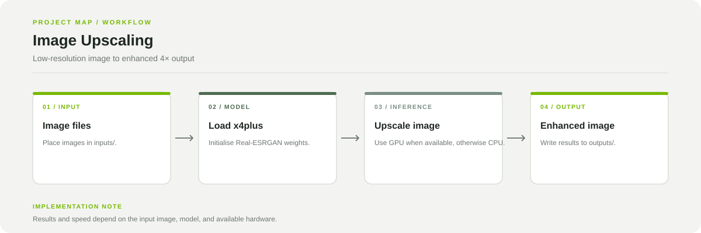

# Image Upscaling with Real-ESRGAN

A notebook workflow for increasing image resolution with Real-ESRGAN x4plus.

**Stack:** Python, PyTorch, Real-ESRGAN, CUDA (optional), Jupyter Notebook



## Pipeline

1. Place source images in `inputs/`.
2. Load the Real-ESRGAN x4plus model weights.
3. Run inference on each image, using CUDA when available.
4. Save enhanced images under `outputs/`.

## Run locally

```bash
git clone https://github.com/chyk2468/Image-Upscaling-py.git
cd Image-Upscaling-py
pip install -r requirment.txt
```

Open and run `unblur.ipynb` in Jupyter Notebook. Check the notebook for the expected input/output folders and model path.

## Repository map

- `unblur.ipynb`: image upscaling pipeline
- `RealESRGAN_x4plus.pth`: model weights
- `inputs/`: source images
- `outputs/`: generated images

## Notes

Upscaling adds model-generated detail and is not a guarantee of recovering the original scene. Inspect output for unwanted artifacts. GPU acceleration requires compatible drivers and a matching PyTorch installation.
